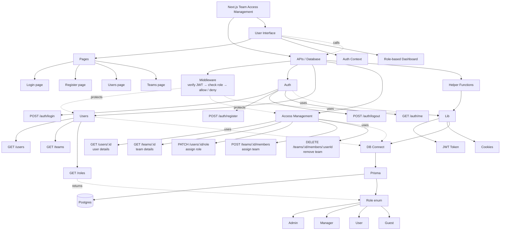
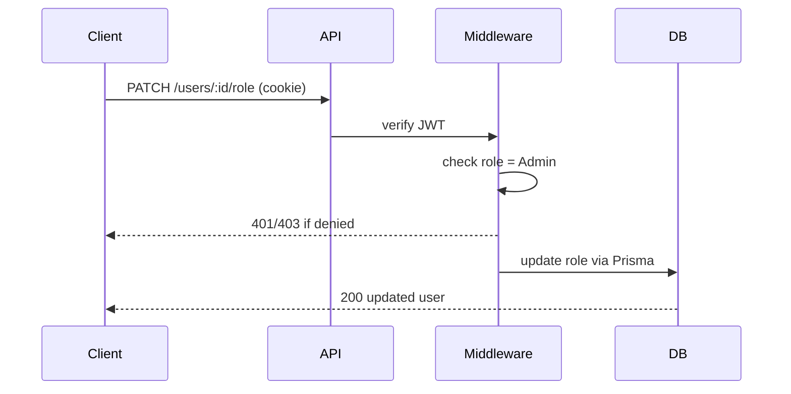

# Crewbase: Team & RBAC Management Platform

**Status:** In progress | **Stack:** Next.js 16, Prisma, PostgreSQL | **Repo:** [link](https://github.com/itsarman001/crewbase.git) | **YouTube:** [link](https://youtu.be/b05ky3LdzKU)
## Why I'm building this
I came across this project and saw it covers everything I need to start my backend journey. I'm documenting what I learn, what I do differently from the original, and the features I add myself.

## Learning checklist

**Foundations**
- [ ] Next.js 16 and its folder/file structure
- [ ] Pages and layouts
- [ ] App Router (route groups, dynamic routes)
- [ ] Server vs client components

**Backend**
- [ ] Prisma schema and client setup
- [ ] PostgreSQL
- [ ] REST API routes
- [ ] JWT auth and cookies
- [ ] Login and register flow
- [ ] Protected API routes
- [ ] RBAC (admin management and users)

**Frontend integration**
- [ ] Auth context
- [ ] Forms with `useActionState`
- [ ] API integration with the UI
- [ ] Role-based dashboard
- [ ] Server mutations

**Quality**
- [ ] App testing

## Dependencies
| Package | Why | Dev only |
|---|---|---|
| `@prisma/client` | Type-safe database client used in API routes | No |
| `prisma` | CLI for schema, migrations, client generation | Yes (usually) |
| `bcryptjs` | Hashes passwords (pure JS, no native build) | No |
| `jsonwebtoken` | Signs and verifies JWTs | No |
| `@types/bcryptjs` | TypeScript types | Yes |
| `@types/jsonwebtoken` | TypeScript types | Yes |

## Architecture

## Auth and RBAC request flow

## What I changed or added
- (e.g. Manager and Guest roles, team member endpoints)

## Challenges and fixes
- (short entries: symptom, cause, fix)

## Progress log
- 2026-10-23: started documenting
