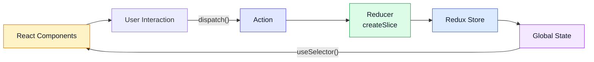

# Redux Toolkit

> Status: 🚧 In progress | Stack: React + TypeScript | Started: 2026-10-29

## 1. Why Redux

- Centralized data: one store as the single source of truth
- Predictable state management: state changes only through actions and reducers
- Avoids prop drilling: any component can read from the store

## 2. Why Redux Toolkit (vs plain Redux)

| Problem in plain Redux                               | How RTK fixes it                                |
| ---------------------------------------------------- | ----------------------------------------------- |
| Lots of boilerplate (action types, creators, switch) | `createSlice` generates actions and reducer     |
| Easy to mutate state by accident                     | Immer lets you write "mutating" code safely     |
| Verbose store setup                                  | `configureStore` has good defaults and devtools |
| Hand-written async logic                             | `createAsyncThunk`, RTK Query                   |

## 3. Architecture


## 4. Core API

| API | Purpose | Notes |
|---|---|---|
| `configureStore` | Creates the store | |
| `createSlice` | State + reducers + actions in one | |
| `Provider` | Makes the store available to React | |
| `useSelector` | Read state | |
| `useDispatch` | Send actions | |

### Setup (TypeScript)

```ts
// store.ts
// TODO: paste your configureStore + RootState + AppDispatch

// hooks.ts
// TODO: typed useAppSelector / useAppDispatch
```

## 5. createSlice

```ts
// TODO: paste your slice (name, initialState, reducers, PayloadAction<T>)
```

- What `createSlice` auto-generates:
- Why "mutating" state is safe here (Immer):
- What breaks Immer (mutating AND returning a new value):

## 6. Using it in components

```tsx
// TODO: useAppSelector + useAppDispatch example
```

- Selector rules (select the minimum, avoid creating new objects):

## 7. Async: createAsyncThunk

- Lifecycle: `pending` → `fulfilled` / `rejected`
- Handled in `extraReducers`

```ts
// TODO
```

## 8. RTK Query

- `createApi`, endpoints, caching, auto-generated hooks
- When to use it instead of thunks:

```ts
// TODO
```

## 9. When NOT to use Redux

| Situation | Better option |
|---|---|
| Local component state | `useState` / `useReducer` |
| Simple shared state | Context |
| Lightweight global state | Zustand |
| Server state / caching | RTK Query or TanStack Query |

## 10. Mistakes I made

| Mistake | Cause | Fix |
|---|---|---|
| | | |

## 11. Interview Q&A

- **What is a reducer, and why must it be pure?**
  -
- **What is middleware?**
  -
- **Redux vs Context?**
  -
- **Why is Immer used?**
  -

## 12. Practice / Code

- Repo / folder:
- Mini projects built:

## 13. Resources

- Official docs: https://redux-toolkit.js.org