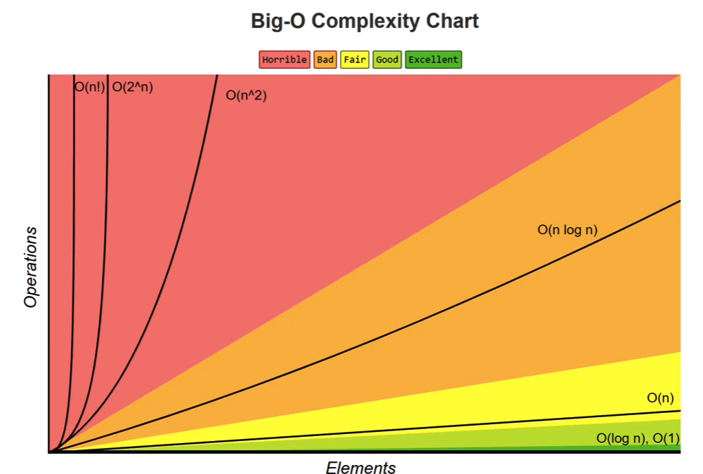

# Big-O Notation

## What Is Big-O Notation?

**Big-O notation** describes the time or space complexity of an algorithm in terms of its input size.

It is commonly used to represent the **worst-case time complexity** of an algorithm.

Big-O has two important characteristics:

1. **Input-dependent:** Complexity is expressed in terms of the input size, usually represented by `n`.
    
2. **Focuses on the bigger picture:** It describes the overall growth rate without getting caught up in constant factors or minor details.
    

## Time Complexity

Time complexity describes how the number of operations performed by an algorithm grows as the input size increases.

### Example 1: Linear Time Complexity — $O(n)$

```
function sum(n) { // suppose n = 4
    let sum = 0; // executes 1 time

    for (let i = 1; i <= n; i++) {
        sum += i; // executes n times
    }

    return sum; // executes 1 time
}
```

**Operation count:**

- Variable initialization: `1`
    
- Loop body: `n`
    
- Return statement: `1`
    

Total operations:

$$T(n) = n + 2$$

Since Big-O ignores constant terms, the complexity is $O(n)$.

This is called **Linear Time Complexity** because the number of operations grows proportionally with the input size.

### Example 2: Constant Time Complexity — $O(1)$

```
function sum1(n) {
    return (n * (n + 1)) / 2; // executes 1 time
}
```

Regardless of the input size, the formula executes a fixed number of operations.

Therefore, the time complexity is $O(1)$.

This is called **Constant Time Complexity** because the number of operations does not depend on the input size.

## Common Time Complexities

There are several other time complexities to understand:

|Big-O Notation|Complexity|
|---|---|
|$O(1)$|Constant|
|$O(\log n)$|Logarithmic|
|$O(n)$|Linear|
|$O(n \log n)$|Linearithmic|
|$O(n^2)$|Quadratic|
|$O(n^3)$|Cubic|
|$O(2^n)$|Exponential|

I will explore these complexities in more detail as I progress through the course and track my learning.

## Big-O Complexity Chart



_Visual comparison of common Big-O time complexities._

## Space Complexity

Space complexity describes how much memory an algorithm requires as the input size grows.

### 1. $O(1)$ — Constant Space

The algorithm uses a fixed amount of extra memory, regardless of the input size.

### 2. $O(n)$ — Linear Space

The extra memory required grows proportionally with the input size.

### 3. $O(\log n)$ — Logarithmic Space

The extra memory grows logarithmically with the input size.

## Notes and Key Takeaways

1. **Multiple solutions:** The same problem can be solved using different algorithms. There is no single solution that is always the best. Different algorithms perform better under different constraints.
    
2. **Different implementations:** The same algorithm, even in the same programming language, can be implemented in different ways.
    
3. **Code readability matters:** When writing programs professionally, don't lose sight of the bigger picture. Instead of writing clever code, prioritize code that is simple to read, understand, and maintain.